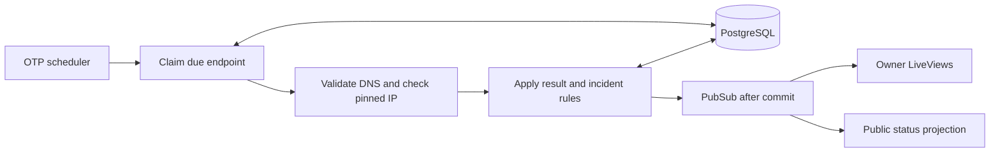

# Architecture

Guru Signal is a Phoenix monolith designed for one owner, one application node,
and one region. LiveView handles interactive pages; Ecto provides database access;
OTP supervises the scheduler and background tasks. PostgreSQL holds monitoring
configuration, check attempts, and incidents.

## Data flow

The scheduler polls every second and dispatches at most four concurrent checks.
Missed intervals are not replayed. A small supervised scheduler keeps the MVP
simple; a durable job queue would become useful for retries, backlog management,
or a broader deployment topology.

## Modules and data

| Location | Responsibility |
| --- | --- |
| `lib/guru_signal/monitoring/` | Endpoint configuration, checks, incidents, retention, HTTP policy |
| `lib/guru_signal/owner_access.ex` | Single-owner credentials and in-memory sessions |
| `lib/guru_signal_web/` | Controllers, LiveViews, components, and authentication hooks |
| `priv/repo/migrations/` | Database schema and constraints |
| `assets/` | CSS and JavaScript |
| `test/` | Domain, database, transport, and web tests |

An **endpoint** stores request configuration, a configuration version, scheduling
state, and consecutive success/failure counters. A **check run** stores a numbered
attempt, its configuration snapshot, lease, and normalized result. An **incident**
records its opening and resolution times and references the confirming checks.

Supported intervals are 60, 300, and 900 seconds. Timeouts range from 1–10 seconds;
expected HTTP statuses range from 200–599. Endpoint names are public service labels.

## Consistency

1. A short transaction locks an endpoint, verifies eligibility, creates a pending
   attempt with a lease, and advances its sequence and next due time.
2. DNS resolution and HTTP run outside the transaction under a deadline.
3. Completion locks the endpoint again and checks the lease, sequence,
   configuration version, and enabled state. It commits an accepted result,
   counters, and any incident transition together.

Duplicate completions cannot apply twice. Superseded, expired, or old-configuration
results cannot change current incident state. Database constraints reinforce
sequence ordering, result shape, and the one-pending-check/one-open-incident rules.
This protects database transitions; it does not guarantee exactly-once network I/O.

Endpoint edits use optimistic locking to reject stale forms. Configuration changes
reset streaks and invalidate older in-flight results; an existing incident stays
open until recovery is confirmed.

## Incident and status rules

Three consecutive accepted failures open an incident. Two consecutive accepted
successes resolve it; opposite results reset the streak. One successful check
within an open incident displays as recovering.

Public status considers result freshness as well as incident state. Missing,
future-dated, stale, or old-configuration results cannot imply health. The freshness
budget is the interval plus timeout plus ten seconds. Public pages refresh every
30 seconds and on relevant PubSub messages.

PubSub notifications follow commits and trigger fresh database queries. Delivery
is best effort; PostgreSQL remains authoritative. Multi-node scheduling, durable
notifications, teams, and regional quorum are outside this design.
