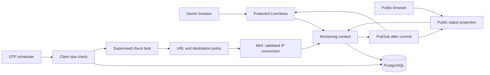

# Initial architecture

This is a proposal, not a description of implemented behavior.

## Application boundary

Use one Phoenix application, PostgreSQL, Ecto, LiveView, and standard Phoenix
assets. The Monitoring context owns endpoint configuration, check persistence,
and incident transitions. Web modules call that context instead of embedding
domain rules. A context is a module boundary around related operations, rather
than a separate service or a dependency-injection container.

LiveView maintains server-side state for each connected view and sends HTML
updates. PubSub announces committed monitoring changes; subscribers reload the
needed data. The database remains authoritative if notifications are missed.

## Proposed data model

- **Endpoint:** name, URL, expected status, supported interval (60/300/900 seconds),
  timeout (1–10 seconds), enabled flag, configuration version, next due time,
  consecutive success/failure counters, and latest applied check sequence.
- **Check run/result:** endpoint, unique identity, per-endpoint sequence,
  configuration version, claim/lease times, check time, completion state, success,
  HTTP status when available, duration, and normalized error category. Pending
  claims and completed results may share a table. No response bodies.
- **Incident:** endpoint, opening check/time, resolving check/time when resolved,
  and safe failure category. A partial unique database index permits only one
  unresolved incident per endpoint.

Changesets validate input before persistence; database constraints protect the
same invariants when callers race or bypass a changeset. Define foreign keys,
unique check identities/sequences, supported values, and positive duration limits
in migrations as well as application code.

## Scheduling and consistency

Start with one supervised GenServer scheduler and a Task.Supervisor with bounded
concurrency. A GenServer is a process with serialized message handling and owned
state; supervision restarts failed processes. It is not an OS thread per monitor.
Network calls run in supervised tasks, never in the scheduler or web processes.

A short database transaction locks an endpoint, checks eligibility, creates a
claim, and advances its due time. Do not hold database locks during network I/O.
Allow only one current claim per endpoint. Expired claims can be superseded;
their eventual results cannot affect current state. Bound the whole operation,
including DNS, connection, and response handling, to the endpoint timeout.

The completion transaction locks the endpoint and verifies the claim identity,
sequence, configuration version, and enabled state. Applying a completed claim
twice is a no-op. A superseded, disabled, or pre-edit result cannot update the
endpoint or its incident. This prevents completion order from rewriting history.
Editing/disabling invalidates claims and resets streaks; an existing incident
remains open until recovery checks or endpoint deletion. Disabled endpoints are
shown as paused rather than healthy. Re-enabling starts fresh streaks.

Domain code resets the opposite counter on each accepted result, opens once on
the third failure, and resolves once on the second success. A newly enabled
endpoint is unknown until checked; one or two failures show a degraded/pending
state without claiming that an incident is open. Broadcast and emit transition
Telemetry only after the database transaction succeeds.

Oban offers persistent jobs, retry handling, and queue tooling, at the cost of
additional migrations and job lifecycle decisions. The initial choice is the
smaller OTP scheduler with persistent claims. No backlog is replayed after
downtime, no exactly-once network request is promised, and no multi-node behavior
is claimed until explicitly tested. Database idempotency still needs concurrent
completion and expired-claim tests.

## SSRF threat model and HTTP boundary

An authenticated owner may accidentally or intentionally configure a URL that
targets local services, metadata, or private networks. A public hostname may
resolve differently between validation and connection. Redirects can change the
destination. Remote servers can stall or send excessive data.

Before outbound checking is enabled:

1. Accept absolute HTTP/HTTPS URLs only. Reject credentials, missing hosts,
   malformed/ambiguous address forms, fragments, and unsupported ports. Initially
   permit HTTP port 80 and HTTPS port 443 only. Never log full URLs/query strings.
2. Resolve at request time, under the overall deadline. Reject local hostnames
   and Fly private names such as `.internal`; hostname rules supplement address
   validation and never replace it.
3. Classify all returned A/AAAA addresses. Reject the destination if any answer
   is prohibited. Reject loopback, private, link-local, unspecified, multicast,
   documentation, shared-address, special-use/reserved ranges, and IPv4-mapped
   IPv6 aliases of blocked IPv4 ranges. Prefer a conservative global-unicast
   policy derived from IANA registries, with explicit edge tests and maintenance.
4. Connect directly to a selected validated IP using Mint, preserving the
   original hostname for Host, SNI, and certificate verification. Do not allow a
   second implicit DNS lookup, proxies, or automatic retry to unvalidated IPs.
   Use a fresh connection per check initially; close it on every exit path.
5. Disable redirects entirely (zero followed redirects). A 3xx is the actual
   observed status and succeeds only when explicitly configured as expected.
6. Use HTTP/1 initially, bounded headers (16 KiB), a 64 KiB response budget, and
   no decompression. Since only status is monitored, close after final response
   headers without consuming a full body. Never persist bodies. Verify how Mint
   handles body bytes arriving in the same socket message and enforce limits.
7. Normalize errors into connection/DNS, TLS, timeout, and unexpected status.
   Treat policy rejection and response-limit rejection as separate safe operational
   categories, not raw exceptions. Never expose internal exception text publicly.

Tests must cover address boundaries, mixed DNS answers, rebinding (assert the
actual connected IP), mapped IPv6, redirects, TLS hostname verification, total
deadlines, oversized headers, and cleanup. Use injected resolver/transport
boundaries and controlled local fixtures; production policy must not gain a
configuration switch that permits private destinations.

Limitations: application checks cannot fully defend against unexpected network
routing, NAT translation, future address allocations, or bugs in classification
and transport. Egress restrictions would provide an additional layer. This is
not yet implemented or a claim of complete SSRF protection.

## Administration and public data

Use a single-owner password login with a server-configured password hash,
constant-time verification via an established password library, login throttling,
session renewal on login, CSRF protection, and secure production cookies. No
registration or account management. Protect both HTTP routes and LiveView mounts;
fail closed if owner configuration is missing. Never place credentials in URLs.
Finalize credential provisioning with implementation and test session expiry.

Public queries expose only service names, derived status, and safe incident
timestamps. They must not select endpoint URLs, request settings, credentials,
or raw diagnostics. Owner diagnostic views remain authenticated.

## Operations and validation

Unit tests cover transition logic and destination policy; PostgreSQL tests cover
constraints, transactional application, and races; LiveView tests cover access
control and updates. HTTP fixtures are deterministic and require no public
Internet. CI will check formatting, warnings-as-errors compilation, and tests
against PostgreSQL. Static analysis will be selected after scaffolding.

Emit bounded-cardinality Telemetry for checks and transitions. Structured logs
contain IDs, safe categories, and timing rather than URL secrets. Plan finite
result retention and a batched cleanup task before deployment so database growth
is bounded; choose the retention period during the results milestone.

Expose a lightweight liveness route and a database readiness route. Fly health
checks use readiness; neither depends on monitored remote endpoints.

Deploy only after approval: one region, one app machine, no autostop, and at least
one running machine because monitoring must continue without incoming requests.
Review generated release/Docker/Fly configuration, database offering and cost,
migration release commands, backups, rollback, and health verification before
creating resources. No cost estimate or deployment success is claimed yet.

## References consulted on 2026-11-09

- [Elixir introduction, v1.20.5](https://elixir.hexdocs.pm/introduction.html)
- [Erlang downloads, OTP 29.1.2](https://www.erlang.org/downloads)
- [Phoenix installation, v1.8.16](https://phoenix.hexdocs.pm/installation.html)
- [LiveView, v1.2.13](https://phoenix-live-view.hexdocs.pm/Phoenix.LiveView.html)
- [Ecto SQL, v3.14.0](https://ecto-sql.hexdocs.pm/Ecto.Adapters.SQL.html)
- [Mint connection options, v1.11.0](https://mint.hexdocs.pm/Mint.HTTP.html)
- [Oban overview](https://oban.hexdocs.pm/Oban.html)
- [Fly Phoenix deployment](https://docs.fly.io/elixir/getting-started)

These are documentation versions observed during research, not a tested lockfile.
Resolve and compile the generated dependency set before declaring compatibility.
